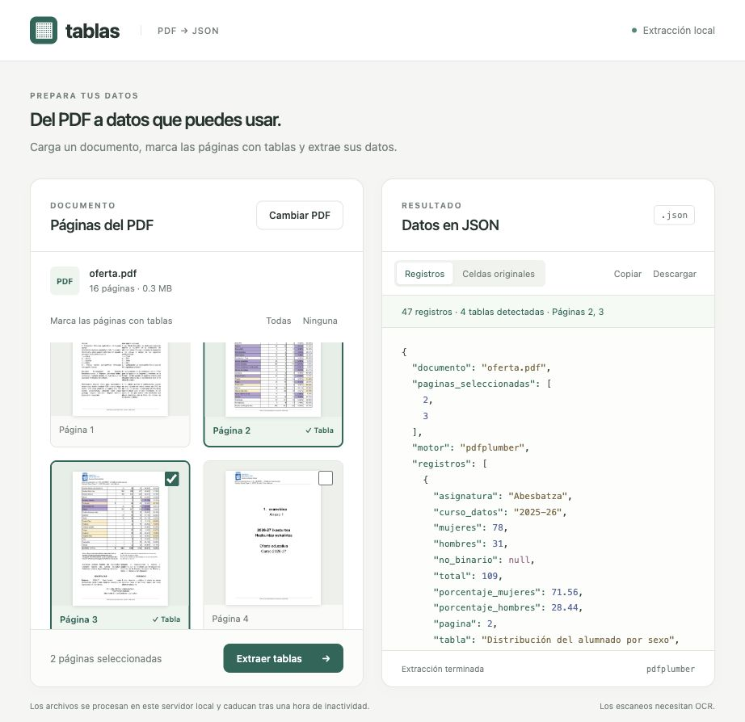

# Tablas · PDF a JSON

Aplicación web para cargar un PDF, seleccionar las páginas con tablas y extraer sus datos con **pdfplumber**. Muestra miniaturas y JSON en dos paneles; permite copiar los registros y descargar el resultado completo.



## Docker

```sh
docker compose up -d --build
```

Abre http://127.0.0.1:8766. Para cambiar el puerto del host: `TABLAS_PORT=8770 docker compose up -d`. El servicio escucha únicamente en localhost; nginx ofrece el acceso público.

```sh
docker compose ps
docker compose logs --tail=100 app
docker compose down
```

La imagen usa Python 3.13 y dependencias fijadas en `requirements.lock`, se ejecuta sin root y con sistema de archivos de solo lectura. Los PDF temporales se almacenan en `/tmp` (512 MB, en memoria). El contenedor tiene límites de 1 CPU y 1 GB de RAM y se reinicia automáticamente salvo parada manual. Hay un único worker porque los identificadores de documentos se guardan en memoria.

## Desarrollo sin Docker

Python 3.11 o superior:

```sh
python3 -m venv .venv
.venv/bin/python -m pip install -r requirements.lock
.venv/bin/python -m uvicorn app:app --host 127.0.0.1 --port 8765
```

## Extracción y alcance

- `pdfplumber.find_tables()` extrae celdas usando las líneas de las tablas. PyMuPDF genera las miniaturas.
- Cada tabla conserva las filas originales, página y coordenadas `bbox` en puntos PDF, con origen arriba a la izquierda. `null` representa una posición de celda combinada y `""` una celda sin texto.
- Normaliza el esquema bilingüe de matrículas del PDF de Donostia: asignatura, curso de los datos, mujeres, hombres, no binario, total y porcentajes. Otros esquemas conservan las celdas originales; no se inventan etiquetas.
- Puede heredar el encabezado de la página inmediatamente anterior para una continuación compatible, incluso si solo seleccionas la página 3 del ejemplo. Solo devuelve filas de las páginas seleccionadas.
- Los totales publicados se separan de las asignaturas. Se comprueban las sumas por fila y los porcentajes. Las celdas vacías se mantienen como `null`; contribuyen con cero únicamente en la comprobación de sumas.
- Sin OCR: los escaneos y las tablas sin líneas pueden no detectarse. La interfaz muestra los avisos. Algunos bloques delimitados de texto pueden detectarse como tablas: revisa las celdas originales.
- Límite de 50 MB y 300 páginas por PDF. Los documentos caducan tras una hora sin actividad y se eliminan en la limpieza periódica (cada minuto). Reiniciar el contenedor borra todos los documentos y resultados temporales. No se envían a servicios externos.

## Pruebas

```sh
.venv/bin/python -m pip install -r requirements-dev.txt
.venv/bin/python -m unittest discover -s tests -v
```

Las pruebas generan PDFs: datos numéricos, continuación sin encabezado, celdas vacías, total separado, tabla genérica, escaneo, entradas inválidas, miniaturas y descarga JSON. Con el PDF real de Donostia, las páginas 2 y 3 producen 47 registros: Biola tiene 4 hombres y Dultzaina 2 mujeres, para el curso 2025–26.

## Despliegue con nginx y HTTPS

Servidor: `https://tablas.ikasten.dev`, proyecto en `/opt/tablas-pdf`. El contenedor se publica en `127.0.0.1:8766` y dispone de `/health` para comprobar su estado.

La plantilla de arranque HTTP está en `deploy/tablas.ikasten.dev.conf`. Instálala en `/etc/nginx/sites-available/`, crea el enlace en `sites-enabled/`, valida con `nginx -t` y recarga nginx. Una vez que el registro DNS A apunte al servidor, ejecuta:

```sh
certbot --nginx -d tablas.ikasten.dev --redirect
```

Certbot incorpora el certificado y la redirección HTTPS. La renovación se gestiona con `certbot.timer` del servidor. La app no tiene autenticación; cualquier visitante puede cargar PDF y obtener su resultado. Los documentos usan identificadores aleatorios y no hay listado público.

Para actualizar solo este proyecto:

```sh
cd /opt/tablas-pdf
git pull --ff-only
docker compose up -d --build
docker compose ps
```

No usar `docker system prune` ni parar otros proyectos del servidor.
